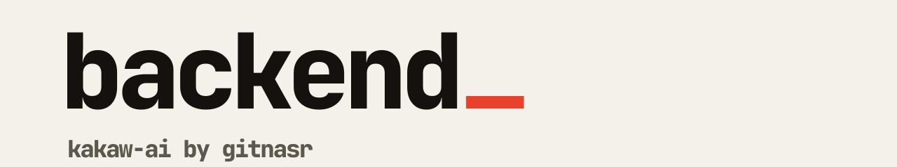

<picture>
  <source media="(prefers-color-scheme: dark)" srcset=".github/banner-dark.svg">
  
</picture>

The API behind [Kakaw AI](https://kakaw.gitnasr.com): sign-in, chat, saved database connections, what Kakaw learns about those databases, and streaming answers back from the [agent](https://github.com/Kakaw-AI/agent).

[Frontend](https://github.com/Kakaw-AI/frontend) · [Agent](https://github.com/Kakaw-AI/agent) · [Monitoring](https://github.com/Kakaw-AI/monitoring) · [Site](https://kakaw.gitnasr.com)

## What is in here

NestJS with Prisma on PostgreSQL. The modules in `src/`:

| Module | What it does |
| --- | --- |
| `auth` | Sign-in with better-auth |
| `users` | User records |
| `chat` | Conversations, messages, artifacts, and streaming from the agent |
| `agent-runtime` | Runtime wiring for the agent |
| `database-sources` | The databases people connect |
| `database-knowledge` | What Kakaw keeps about a connected database |
| `llm-connections` | The LLM provider each user brings |
| `retrieval` | Embeddings and query memory (the model is fetched by `scripts/fetch-embedding-model.cjs`) |
| `storage` | S3 object storage |
| `telemetry.ts` | OpenTelemetry traces, metrics and logs |

## Run it

```bash
npm install
npm run prisma:generate
npm run prisma:migrate     # needs DATABASE_URL
npm run start:dev
```

| Script | |
| --- | --- |
| `npm run build` / `start:prod` | Build with Nest, run `dist/main` |
| `npm test` / `test:watch` | Vitest |
| `npm run lint` | ESLint |
| `npm run prisma:studio` | Browse the database |
| `npm run backfill:query-memory` | Rebuild stored query memory |

## Configuration

Secrets are read from Infisical at boot. Set `INFISICAL_CLIENT_ID`, `INFISICAL_CLIENT_SECRET`, `INFISICAL_PROJECT_ID`, `INFISICAL_ENVIRONMENT`, `INFISICAL_SECRET_PATH` and `INFISICAL_SITE_URL`. `DATABASE_URL` is the PostgreSQL connection string. Never commit a `.env` file.

## Docker

The `Dockerfile` is a multi-stage build on `node:22-slim`. CI builds and publishes the image on pushes to `master` and on `v*` tags.
